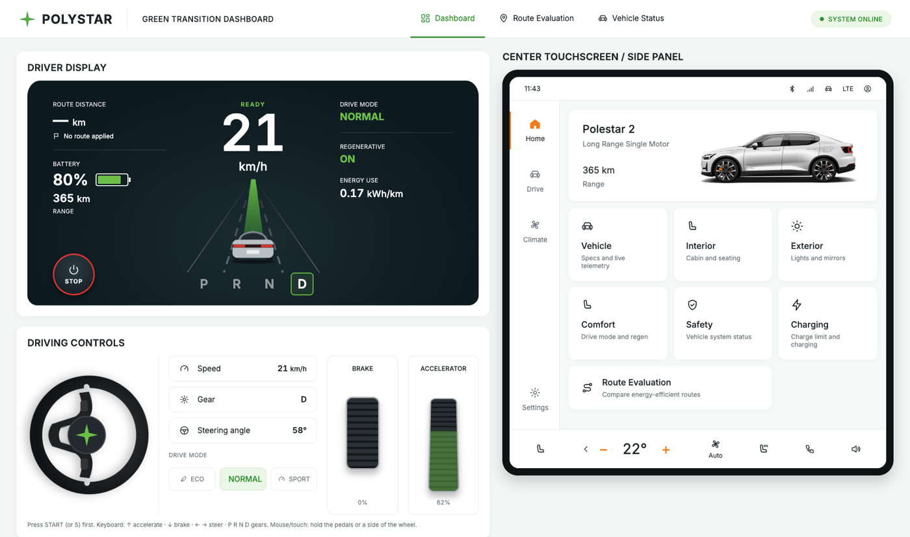
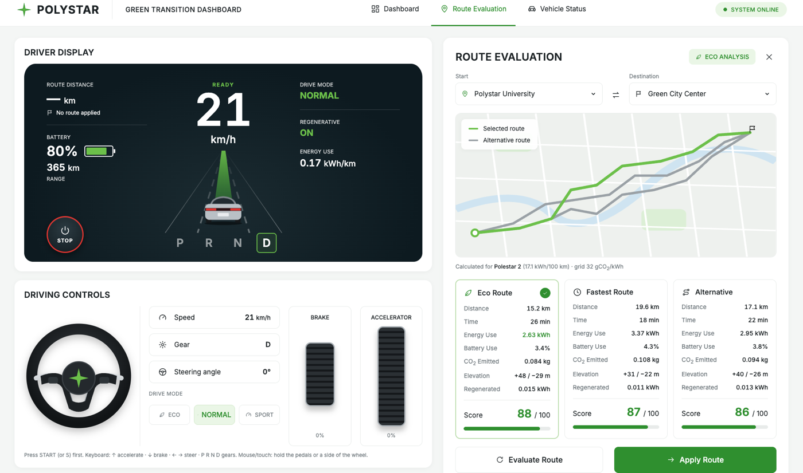
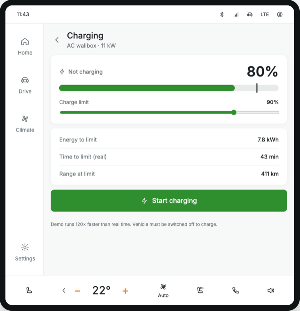

# Green Transition Dashboard

A web dashboard for an **electric vehicle digital twin**. It shows the car's live state together with its **energy use, battery, range and CO₂ emissions**, and compares routes by how much energy they need.

Built as a group project for **LAB REDI 2026 (task 3.4)**, part of the **Electric Mobility Digital Twin (EMDT)** project by LAB University of Applied Sciences and LUT University.



---

## Team

1. Abdul Zeeshan Mirza (group lead)
2. Tao Zhu
3. Tharaka Ranathunga
4. Jurian Hesen

---

## What can it do?

- **Drive the car.** Press **START**, then accelerate, brake and steer with the keyboard, mouse or touch. Speed, battery and energy update live.
- **Energy and CO₂.** Energy use, battery drain, range and CO₂ are calculated with the team's energy model.
- **Route evaluation.** Compare routes, see which is the **Eco** and which the **Fastest** route, and apply one to the driver display.
- **Charging.** Set a charge limit and charge the battery.
- **Safety.** See the status of Motor, Controller, CAN bus, ABS and ESC. A fault stops the car from driving.
- **Six vehicles.** Polestar 2, Tesla Model 3, VW ID.3, Hyundai IONIQ 5, Kia EV6 and Nissan Leaf. Switching car recalculates everything.

| Route Evaluation | Charging |
|---|---|
|  |  |

---

## How to run it on your computer

You only need two free programs. It works the same on **Windows, macOS and Linux**.

### Step 1: Install the tools (only once)

1. **Node.js, version 22 or newer.** Download the **LTS** version from <https://nodejs.org> and install it.
2. **Git.** Download it from <https://git-scm.com> and install it.

To check they work, open a terminal and type:
```bash
node -v    # should show v22 or higher
git --version
```
On Windows, the terminal is **PowerShell** or **Command Prompt**. On macOS, it's the **Terminal** app.

### Step 2: Download the project

```bash
git clone https://github.com/AbdulZeeshan688/Green-Transition-dashboard.git
cd Green-Transition-dashboard
```

> **Note:** until the pull request is merged into `main`, the dashboard is on the branch
> `feature/polystar-dashboard`. Switch to it with:
> ```bash
> git checkout feature/polystar-dashboard
> ```

### Step 3: Install and start

```bash
cd frontend
npm install
npm run dev
```

`npm install` downloads the libraries the project needs, and takes about a minute the first time.

### Step 4: Open it

Open **<http://localhost:5173>** in your browser (Chrome, Edge, Firefox or Safari).

To stop the app, press **Ctrl + C** in the terminal.

> No API keys, accounts or database are needed. The dashboard runs straight away.

---

## How to use it

| Action | Keyboard | Mouse / touch |
|---|---|---|
| Switch the car on / off | **S** | **START / STOP** button |
| Accelerate | **↑** | Hold the accelerator pedal |
| Brake | **↓** | Hold the brake pedal |
| Steer | **← →** | Hold the left or right half of the wheel |
| Change gear | **P R N D** | Click **P R N D** on the display |

- The car must be **switched on** before it can drive.
- You can only switch it **off in P**.
- To charge, switch the car **off** first.

Pages can also be opened directly: `#dashboard`, `#route` and `#vehicle`, for example <http://localhost:5173/#route>.

---

## Other useful commands

Run these inside the `frontend` folder:

| Command | What it does |
|---|---|
| `npm run dev` | Start the dashboard for development |
| `npm test` | Run the automatic tests (formulas, physics and data files) |
| `npm run build` | Make the final version in `frontend/dist/` |
| `npm run preview` | Open the final version at <http://localhost:4173> |
| `npm run dev -- --host` | Open the dashboard from another device on the same Wi-Fi (use the "Network" address it prints) |

---

## Changing the data (no coding needed)

Nothing is hardcoded. Every value comes from a file in **`frontend/public/data/`**. Edit a file, save it, and refresh the browser.

| File | What you can change |
|---|---|
| `vehicles.json` | Cars: battery size, energy consumption, top speed, photo |
| `vehicle-state.json` | Starting battery %, gear, drive mode, car on or off |
| `routes.json` | Places and routes (distance, time, uphill, downhill) |
| `energy-model.json` | Energy factors and the electricity CO₂ value |
| `charging.json` | Charger power and charge-limit range |
| `drive-modes.json` | Eco / Normal / Sport behaviour |
| `scoring.json` | How routes are scored |
| `vehicle-systems.json` | Safety systems and demo scenarios |
| `simulation.json` | Pedal speed, steering speed, animation speed |
| `ui.json` | Tabs, touchscreen tiles and units |

After editing, run `npm test`. It checks all data files and tells you if something is wrong.

---

## How the numbers are calculated

The energy model comes from fellow LAB student **Sanjeev-Kumar Chaudhary**
([his repository](https://github.com/Sanjeev7071/Green-Transition-Dashboard-LAB-REDI-)):

| Value | Formula |
|---|---|
| Energy used (kWh) | `distance × consumption + uphill × 0.001 − downhill × 0.0005` |
| Battery used (%) | `energy ÷ battery capacity × 100` |
| CO₂ (kg) | `energy × electricity CO₂ intensity` (32 g/kWh, Fingrid 2026) |
| Range (km) | `battery energy left ÷ consumption per km` |
| Eco / Fastest route | Fastest = shortest time · Eco = least energy |

More detail is in [`frontend/README.md`](frontend/README.md).

---

## What is in this repository

```
Green-Transition-dashboard/
├── frontend/          ← The Green Transition Dashboard (this is the main project)
│   ├── public/data/   ← All data files (JSON)
│   ├── public/images/ ← Vehicle photos
│   └── src/           ← React code: components, formulas, tests
├── docs/screenshots/  ← Pictures used in this README
├── Documents/         ← Reports, project plan and timesheets
└── src/, index.html, package.json …  ← Earlier prototype by Unubold Luvsandagva (see below)
```

**Built with:** JavaScript, React 18, Vite, Vitest, HTML and CSS.

---

## Earlier prototype (optional)

The files in the root folder (`src/`, `index.html`, `package.json`) are the **earlier prototype by Unubold Luvsandagva**, which our dashboard builds on. It needs a **Google Maps API key**:

```bash
# in the root folder, not in frontend/
npm install
echo "VITE_GOOGLE_MAPS_KEY=your_key_here" > .env
npm run dev
```

The full setup is in [`READMEfromOtherGroup.md`](READMEfromOtherGroup.md).

---

## Problems?

| Problem | Fix |
|---|---|
| `node: command not found` / `npm: command not found` | Install Node.js (Step 1) and open a **new** terminal. |
| `npm install` shows an engine or version error | Your Node.js is too old. Install version **22 or newer**. |
| `Port 5173 is in use` | Another copy is running. Use the address the terminal prints (e.g. `:5174`), or close the other one. |
| Blank page / "Could not load dashboard data" | Don't open `index.html` by double-clicking. Always start with `npm run dev` and open the address it shows. |
| The car won't move | Press **START** first, then shift to **D**. Check that Safety is not set to **Fault**. |
| `frontend` folder not found | Run `git checkout feature/polystar-dashboard` (see Step 2). |

---

## Status and next steps

- [x] Driver display, driving simulation and push-start
- [x] Energy, battery, range and CO₂ with the team energy model
- [x] Route evaluation (Eco / Fastest), charging, safety and vehicle selection
- [x] 45 automatic tests
- [ ] Backend: real routes from OpenRouteService and live CO₂ data from Fingrid
- [ ] Real map (Leaflet / OpenStreetMap)

Routes, the starting battery level and the safety scenarios are **sample data** for now. They will come from the backend.
