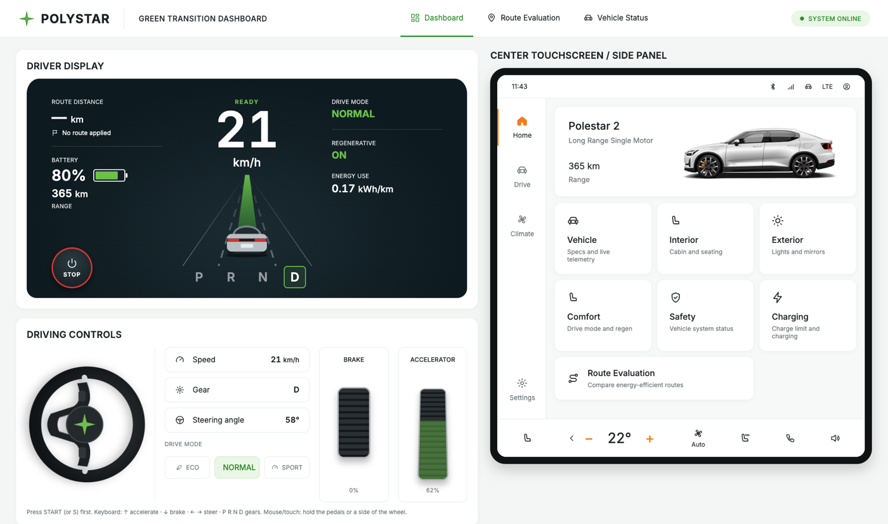
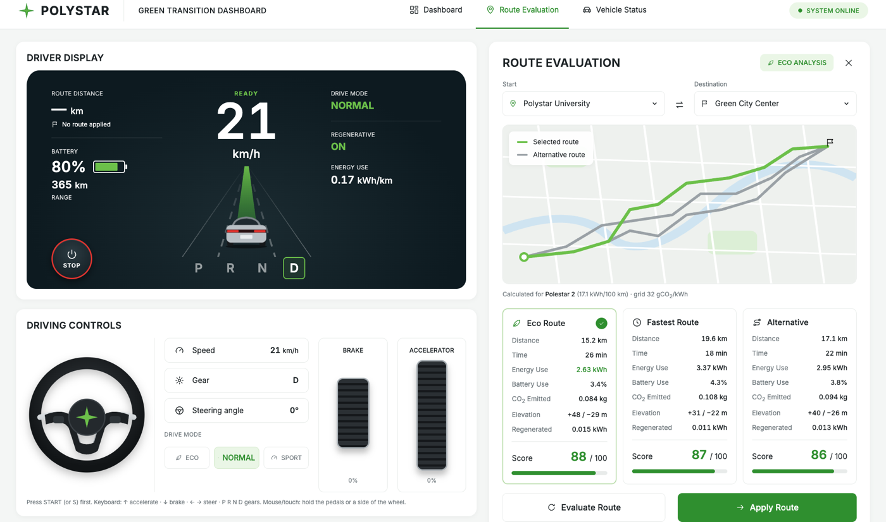
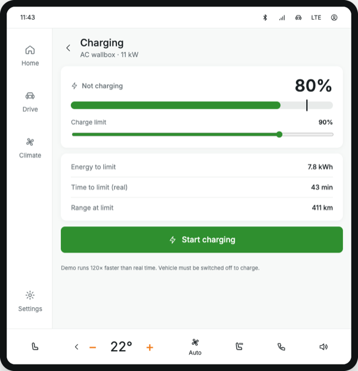

# Green Transition Dashboard

A web dashboard for an **electric vehicle digital twin**. It shows the car's live state together with its **energy use, battery, range and CO₂ emissions**, and compares routes by how much energy they need.

Built as a group project for **LAB REDI 2026 (task 3.4)**, part of the **Electric Mobility Digital Twin (EMDT)** project by LAB University of Applied Sciences and LUT University.

**▶ Live demo: https://green-transition-rg.netlify.app** (runs in any browser, no installation needed)



---

## Team

1. Abdul Zeeshan Mirza (group lead)
2. Tao Zhu
3. Tharaka Ranathunga
4. Jurian Hesen

---

## What can it do?

- **Drive the car.** Press **START**, then accelerate, brake and steer with the keyboard, mouse or touch. Speed, battery and energy update live.
- **Energy and CO₂.** Energy use, battery drain, range and CO₂ are calculated with the team's energy model.
- **Real routes on a real map.** Type any start and destination (for example *LUT Lahti* → *Tampere*). The backend finds the real roads, and the dashboard draws them on an OpenStreetMap map with energy use, battery, CO₂ and a score for each route. The best route is selected automatically, and you can apply it to the driver display.
- **Charging.** Set a charge limit and charge the battery.
- **Safety.** See the status of Motor, Controller, CAN bus, ABS and ESC. A fault stops the car from driving.
- **Six vehicles.** Polestar 2, Tesla Model 3, VW ID.3, Hyundai IONIQ 5, Kia EV6 and Nissan Leaf. Switching car recalculates everything.
- **Every button works like a real car.** Climate (two zones, fan, A/C, defrost, seat and wheel heating), lights (headlights, fog, hazard, ambient colour), doors and openings, turn signals, phone (demo) and volume. Warning lights appear on the driver display.
- **Ready for the other teams.** A real steering wheel (CARLA team) can be switched on in **Settings**. See [docs/INTEGRATION.md](docs/INTEGRATION.md).

| Route Evaluation | Charging |
|---|---|
|  |  |

---

## How to run it on your computer

You only need two free programs. It works the same on **Windows, macOS and Linux**.

### Step 1: Install the tools (only once)

1. **Node.js, version 22 or newer.** Download the **LTS** version from <https://nodejs.org> and install it.
2. **Git.** Download it from <https://git-scm.com> and install it.

To check they work, open a terminal and type:
```bash
node -v    # should show v22 or higher
git --version
```
On Windows, the terminal is **PowerShell** or **Command Prompt**. On macOS, it's the **Terminal** app.

### Step 2: Download the project

```bash
git clone https://github.com/AbdulZeeshan688/Green-Transition-dashboard.git
cd Green-Transition-dashboard
```

### Step 3: Install and start

```bash
cd frontend
npm install
npm run dev
```

`npm install` downloads the libraries the project needs, and takes about a minute the first time.

### Step 4: Open it

Open **<http://localhost:5173>** in your browser (Chrome, Edge, Firefox or Safari).

To stop the app, press **Ctrl + C** in the terminal.

> The dashboard opens without the backend, but the **Route** page then shows an error. Start the backend too (next section) to search real routes. If you only want the sample routes, choose **Settings → Route data → Sample routes**.

---

## Running the backend (for real routes)

The `backend/` folder is a **C# Azure Function** (.NET 10). The LAB team asked us to use C#, so it replaced the earlier Python version. It finds real routes with **OpenRouteService** and calculates energy and CO₂ for each route. The dashboard uses it on the **Route** page.

### Step 1: Install the tools (only once)

1. **.NET 10 SDK** from <https://dotnet.microsoft.com/download/dotnet/10.0>. Take version **10**, not 11, because the project is built for .NET 10.
2. **Azure Functions Core Tools v4** from <https://learn.microsoft.com/azure/azure-functions/functions-run-local>.

On a Mac with Homebrew, these commands do the same:
```bash
brew install --cask dotnet-sdk@10
brew tap azure/functions
brew trust azure/functions
brew install azure-functions-core-tools@4
```

Open a **new** terminal afterwards and check:
```bash
dotnet --version   # should start with 10
func --version     # should start with 4
```

### Step 2: Add the API key (only once)

Copy `backend/GreenTransition.Backend/local.settings.example.json` to `local.settings.json` in the same folder, and put your free OpenRouteService key (from <https://openrouteservice.org>) in `ORS_API_KEY`. This file is git-ignored, so the key never goes to GitHub.

No key? It still works with the demo routes in `backend/GreenTransition.Backend/data/demo_routes.json`.

### Step 3: Start it

```bash
cd backend/GreenTransition.Backend
func start
```
The first start takes a minute or two. It's ready when you see `routes: [POST] http://localhost:8000/api/routes`.

### Run everything together

Use **two terminals** (in VS Code, the **+** in the terminal panel):

| Terminal 1: backend | Terminal 2: dashboard |
|---|---|
| `cd backend/GreenTransition.Backend` | `cd frontend` |
| `func start` | `npm run dev` |

Then open **<http://localhost:5173/#route>**, search for a start and a destination, and the real routes appear on the map.

- **Backend tests:** `cd backend` and then `dotnet test`.
- More details are in [`backend/README.md`](backend/README.md).

---

## Hosting on Azure

The dashboard is moving to **Azure Static Web Apps** as part of the team's Azure pipeline (IoT Hub → Azure Functions in C# → REST API → Static Web App). The GitHub workflow in `.github/workflows/` tests, builds and deploys it on every merge to `main`, and gives every pull request its own preview site.

Setup steps (once, in the team's Azure resource group): [docs/AZURE.md](docs/AZURE.md).

---

## How to use it

| Action | Keyboard | Mouse / touch |
|---|---|---|
| Switch the car on / off | **S** | **START / STOP** button |
| Accelerate | **↑** | Hold the accelerator pedal |
| Brake | **↓** | Hold the brake pedal |
| Steer | **← →** | Hold the left or right half of the wheel |
| Change gear | **P R N D** | Click **P R N D** on the display |
| Turn signals / hazard | **Q** / **E** / **H** | Exterior → Hazard lights |

- The car must be **switched on** before it can drive.
- You can only switch it **off in P**.
- To charge, switch the car **off** first.

Pages can also be opened directly: `#dashboard`, `#route` and `#vehicle`, for example <http://localhost:5173/#route>.

---

## Other useful commands

Run these inside the `frontend` folder:

| Command | What it does |
|---|---|
| `npm run dev` | Start the dashboard for development |
| `npm test` | Run the automatic tests (formulas, physics and data files) |
| `npm run build` | Make the final version in `frontend/dist/` |
| `npm run preview` | Open the final version at <http://localhost:4173> |
| `npm run mock-wheel` | Start a fake steering wheel for testing the CARLA connection |
| `npm run dev -- --host` | Open the dashboard from another device on the same Wi-Fi (use the "Network" address it prints) |

---

## Changing the data (no coding needed)

Nothing is hardcoded. Every value comes from a file in **`frontend/public/data/`**. Edit a file, save it, and refresh the browser.

| File | What you can change |
|---|---|
| `vehicles.json` | Cars: battery size, energy consumption, top speed, photo |
| `vehicle-state.json` | Starting battery %, gear, drive mode, car on or off |
| `routes.json` | Sample places and routes, used only when the backend is switched off in Settings |
| `energy-model.json` | Energy factors and the electricity CO₂ value |
| `charging.json` | Charger power and charge-limit range |
| `drive-modes.json` | Eco / Normal / Sport behaviour |
| `scoring.json` | How routes are scored |
| `map.json` | Street map tiles, start position and zoom of the route map |
| `vehicle-systems.json` | Safety systems and demo scenarios |
| `simulation.json` | Pedal speed, steering speed, animation speed |
| `cabin.json` | Climate, lights, doors, audio and phone settings |
| `integrations.json` | Steering wheel and backend addresses, place search, default sources |
| `ui.json` | Tabs, touchscreen tiles and units |

After editing, run `npm test`. It checks all data files and tells you if something is wrong.

---

## How the numbers are calculated

The energy model comes from fellow LAB student **Sanjeev-Kumar Chaudhary**
([his repository](https://github.com/Sanjeev7071/Green-Transition-Dashboard-LAB-REDI-)):

| Value | Formula |
|---|---|
| Energy used (kWh) | `distance × consumption + uphill × 0.001 − downhill × 0.0005` |
| Battery used (%) | `energy ÷ battery capacity × 100` |
| CO₂ (kg) | `energy × electricity CO₂ intensity` (32 g/kWh, Fingrid 2026) |
| Range (km) | `battery energy left ÷ consumption per km` |
| Eco / Fastest route | Fastest = shortest time · Eco = least energy |

More detail is in [`frontend/README.md`](frontend/README.md).

---

## What is in this repository

```
Green-Transition-dashboard/
├── frontend/          ← The Green Transition Dashboard (this is the main project)
│   ├── public/data/   ← All data files (JSON)
│   ├── public/images/ ← Vehicle photos
│   └── src/           ← React code: components, formulas, tests
├── backend/           ← C# Azure Function: real routes (OpenRouteService), energy and CO₂
│   ├── GreenTransition.Backend/        ← the API
│   └── GreenTransition.Backend.Tests/  ← its tests
├── .github/workflows/ ← Azure Static Web App deployment (build, test, deploy)
├── docs/              ← Azure hosting guide, integration guide, screenshots
├── Documents/         ← Reports, project plan and timesheets
└── src/, index.html, package.json …  ← Earlier prototype by Unubold Luvsandagva (see below)
```

**Built with:** JavaScript, React 18, Vite, Vitest, Leaflet and OpenStreetMap, HTML and CSS (frontend) · C#, .NET 10, Azure Functions, xUnit (backend).

---

## Earlier prototype (optional)

The files in the root folder (`src/`, `index.html`, `package.json`) are the **earlier prototype by Unubold Luvsandagva**, which our dashboard builds on. It needs a **Google Maps API key**:

```bash
# in the root folder, not in frontend/
npm install
echo "VITE_GOOGLE_MAPS_KEY=your_key_here" > .env
npm run dev
```

The full setup is in [`READMEfromOtherGroup.md`](READMEfromOtherGroup.md).

---

## Problems?

| Problem | Fix |
|---|---|
| `node: command not found` / `npm: command not found` | Install Node.js (Step 1) and open a **new** terminal. |
| `npm install` shows an engine or version error | Your Node.js is too old. Install version **22 or newer**. |
| `Port 5173 is in use` | Another copy is running. Use the address the terminal prints (e.g. `:5174`), or close the other one. |
| Blank page / "Could not load dashboard data" | Don't open `index.html` by double-clicking. Always start with `npm run dev` and open the address it shows. |
| The car won't move | Press **START** first, then shift to **D**. Check that Safety is not set to **Fault**. |
| `frontend` folder not found | Make sure you have the latest `main`: run `git checkout main` and then `git pull`. |
| `func: command not found` | Install Azure Functions Core Tools (backend Step 1) and open a **new** terminal. |
| `func start` complains about the .NET version | You have .NET 11 instead of 10. Install the .NET **10** SDK (on a Mac: `brew uninstall --cask dotnet-sdk`, then `brew install --cask dotnet-sdk@10`). |
| Route page: "Could not get routes" | The backend is not running. Start it with `func start` (see *Running the backend*). |
| No suggestions when typing a place | The place search needs an internet connection. |

---

## Status and next steps

- [x] Driver display, driving simulation and push-start
- [x] Energy, battery, range and CO₂ with the team energy model
- [x] Route evaluation (Eco / Fastest), charging, safety and vehicle selection
- [x] All touchscreen and bottom-bar buttons working (climate, lights, doors, phone, audio)
- [x] Backend API in C# (Azure Function): real routes from OpenRouteService with energy and CO₂ per route (12 tests)
- [x] Dashboard uses the backend for routes by default
- [x] Real map (Leaflet / OpenStreetMap) and search for any start and destination
- [x] Route scores shown straight away, best route pre-selected
- [x] Steering input ready for the CARLA team's wheel (Settings → Steering input)
- [x] 80 automatic frontend tests
- [x] Dashboard hosted online on Netlify (`netlify.toml`)
- [x] Real routes from the backend tested locally with an OpenRouteService key
- [ ] Agree on one energy model for frontend and backend
- [ ] Connect the real CARLA steering wheel
- [ ] Live electricity CO₂ data from Fingrid
- [x] Azure Static Web App pipeline ready (GitHub Actions workflow + `staticwebapp.config.json`)
- [ ] Create the Static Web App in the team's Azure resource group and add the deploy token
- [ ] Host the backend on Azure, so the online demo can show real routes too

On your computer, routes come from the backend. The online demo on Netlify still uses the **sample routes**, because the backend isn't hosted online yet. The starting battery level and safety scenarios are sample data, and the phone screen is a demo; no real phone is connected.
